**Disciplina:** Redes de Computadores — IFSP Jacareí

**Grupo:** Grupo 1 (individual)

**Integrantes:** Pedro de Moraes Machado

**Servidor:** simulado em contêiner Docker (`ssh -p 2222 root@localhost`)   **Data:** 25/10/2026

---

**Como entregar:** ao longo da aula, cada handout pede uma **Entrega numerada**
(print ou resposta). Cole aqui o print ou escreva a resposta de cada uma,
na ordem. Numere conforme o handout.

---

# Parte 1 — SSH

### Entrega 1 — Print do terminal logo após conectar (mostrando `root@aula-grupoX:~#`)

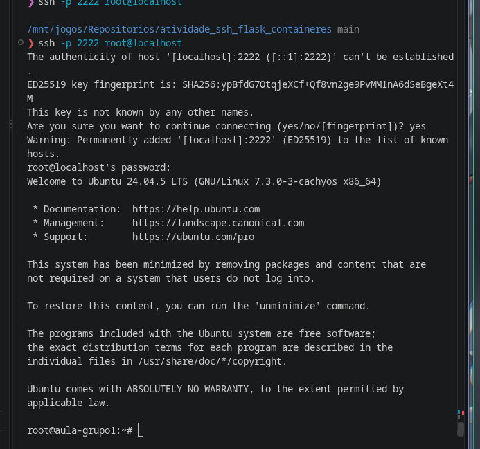

### Entrega 2 — Print do conteúdo do arquivo criado no `nano`, exibido pelo `cat`

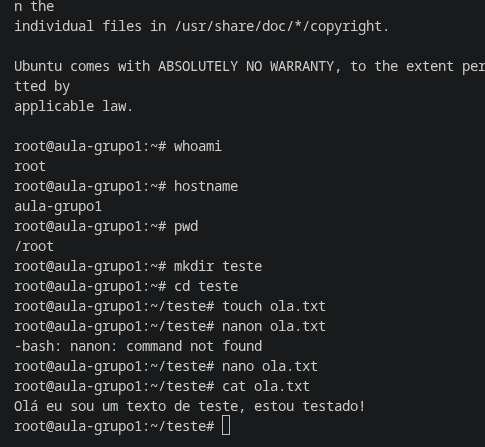

### Entrega 3 — Print do `nproc` e `free -h`

Quantos **núcleos** de processador e quanta **memória RAM** tem o servidor do grupo?

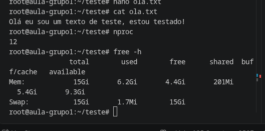

Resposta: o servidor tem **12 núcleos** de processador (`nproc`) e **15 GiB** de memória RAM (`free -h`). (Servidor simulado em contêiner, que usa os recursos da máquina hospedeira.)

### Entrega 4 — Por que o SSH usa a porta 53 e não a porta 22 (a padrão)?

Resposta: a porta 22 é a padrão do SSH, mas redes institucionais como a do IFSP costumam bloqueá-la. A porta 53 é a do DNS, que praticamente nenhuma rede bloqueia, porque sem DNS não se acessa a internet. Usando a 53, o SSH consegue passar pelo bloqueio e conectar no servidor.

### Entrega 5 — Print da sua **chave pública** (`id_ed25519.pub`)

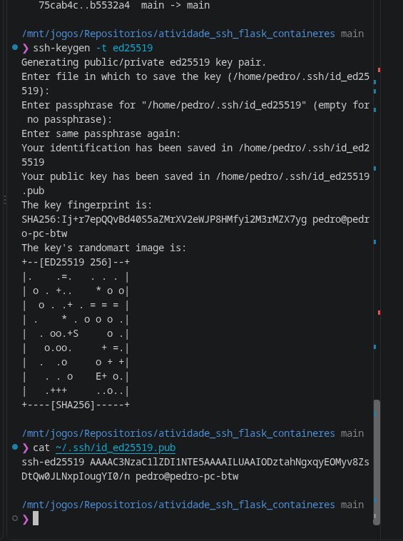

---

# Parte 2 — Flask

### Entrega 6 — Print do `ls` após o `git clone`

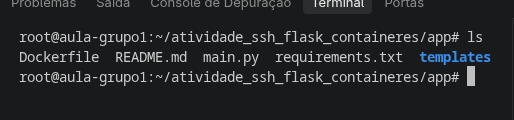

### Entrega 7 — Print de `http://IP:5000` com os nomes do grupo

(Se a porta 5000 estiver bloqueada na rede, escreva *"porta 5000 bloqueada"*.)

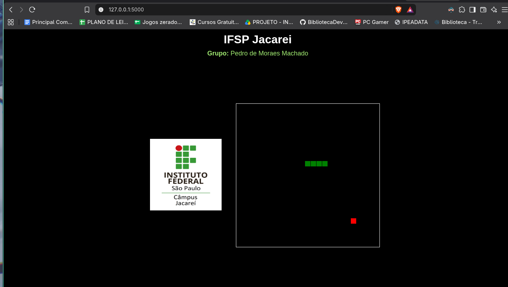

A porta 5000 **não** estava bloqueada: o site abriu normalmente (servidor simulado, acessado em `127.0.0.1:5000`).

### Entrega 8 — Print de `http://IP` (porta 80) com os nomes do grupo

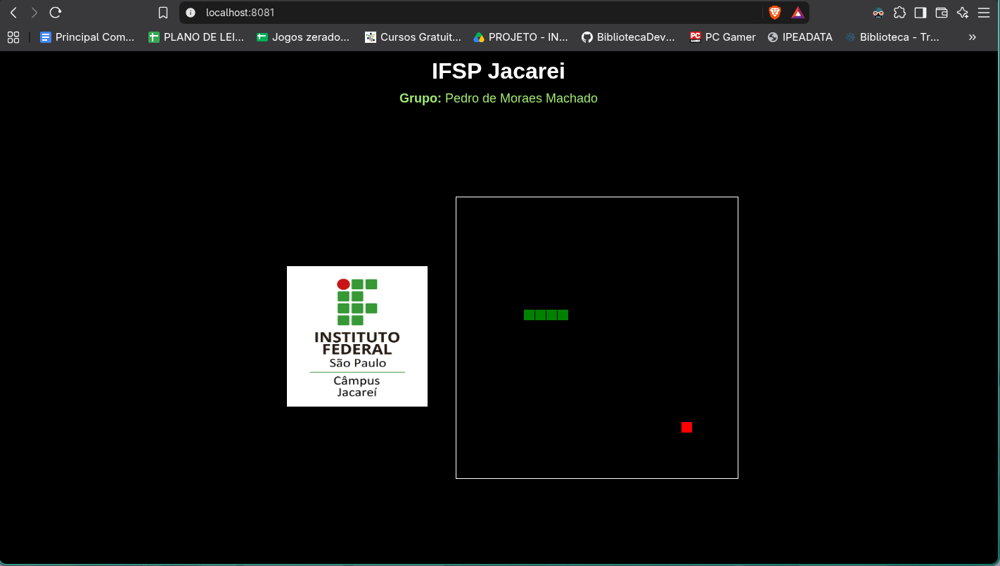

Por que não precisamos mais digitar a porta na URL?

Resposta: porque a porta 80 é a **porta padrão da web (HTTP)**: quando a URL não tem `:porta`, o navegador usa a 80 automaticamente. Por isso sites como `google.com` não mostram número de porta. (Nesta simulação o navegador usa `localhost:8081` porque o Docker mapeia a porta 8081 do meu PC para a 80 do servidor simulado; num servidor real bastaria `http://IP`.)

### Entrega 9 — Print do erro em `http://IP/pagina99`

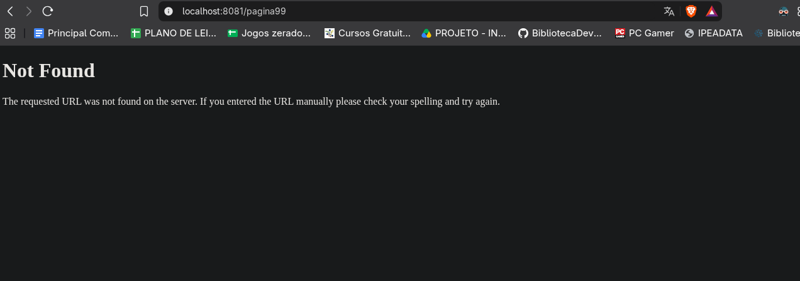

Que erro apareceu e por quê?

Resposta: apareceu o erro **404 Not Found**. Ele acontece porque a rota `/pagina99` não existe no Flask: o `main.py` só define a rota `/` (`@app.route("/")`), então o servidor não sabe o que responder para qualquer outro caminho.

### Entrega 10 — Print do site **fora do ar** depois do `Ctrl + C` + `exit`

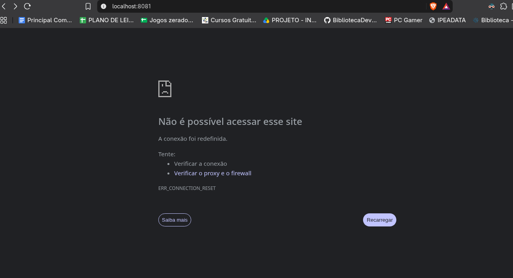

Por que ele caiu?

Resposta: porque o `python3 main.py` roda **preso ao terminal da sessão SSH**. Ao dar `Ctrl + C` e `exit`, a conexão é encerrada e o processo morre junto, então nada fica escutando na porta 80 e o navegador não consegue mais conectar (`ERR_CONNECTION_RESET`). O site só ficava no ar enquanto eu estava conectado.

---

# Parte 3 — Contêiner (Docker)

### Entrega 11 — Print do final do `docker build` (`Successfully built / tagged`)

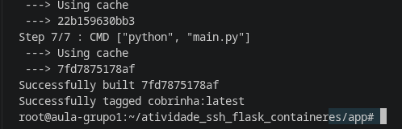

### Entrega 12 — Print do `docker ps` com o contêiner `cobrinha` em `Up`

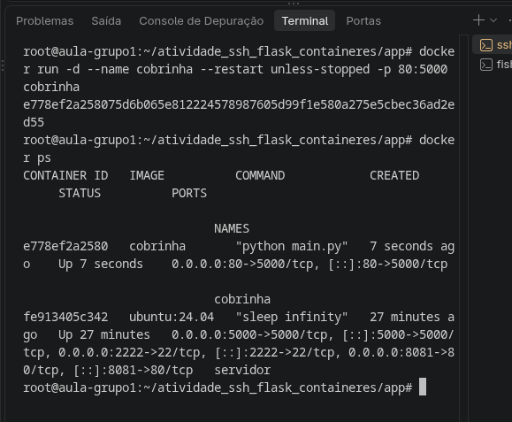

### Entrega 13 — Print de `http://IP` **depois** do `exit` (o site continua no ar)

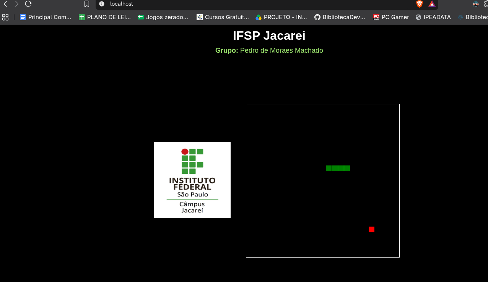

### Entrega 14 — Print do `docker logs cobrinha` **ou** do `docker stats`

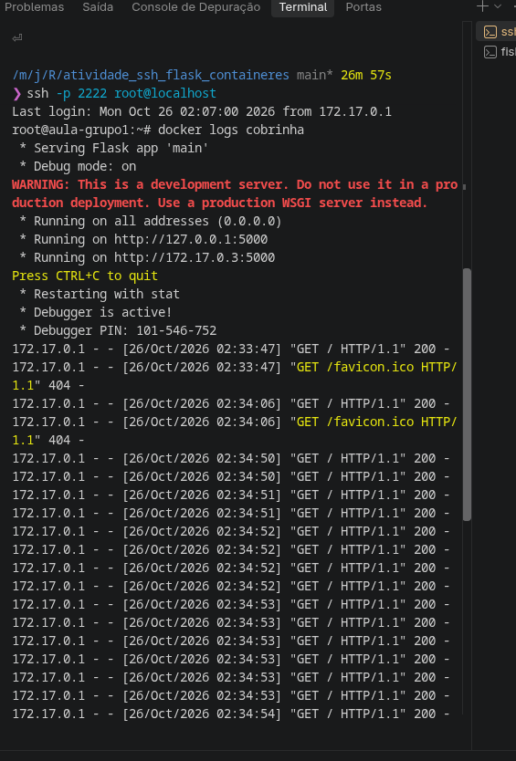

### Entrega 15 — Print de **dentro** do contêiner (`ls` e `cat main.py`)

\
\
\

### Entrega 16 (fechamento) — Diferença entre `python3 main.py` e Docker

Por que só o contêiner continua no ar depois que você desconecta?

Resposta: ______________________________________________
\
\
\
